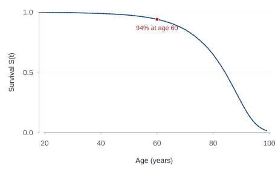
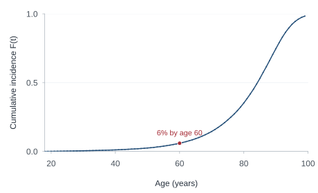
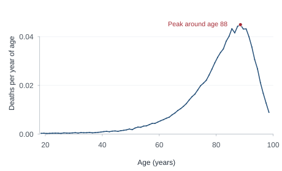
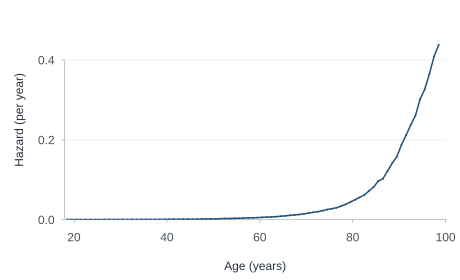
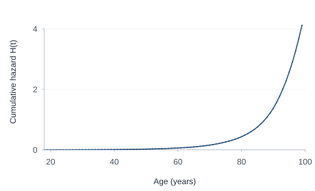
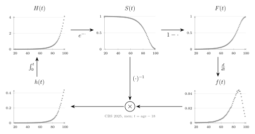

Survival analysis comes with quite a collection of functions: survival, cumulative incidence, density, hazard, and cumulative hazard. When you first encounter them, it can feel as though each needs its own definition to memorize. Yet they all describe the same distribution of event times. Once you know one, you can work out the others.

I've been thinking about a way to introduce these functions that makes their connections easier to remember. Start with the survival curve, follow a few simple operations, and you end up back where you started. I call it the **circle of survival**.

As you scroll, the circle builds alongside the explanation. Each new connection appears in red. [The original, static version is here too](static.qmd).

Let's walk around the circle, using the survival of Dutch men as an example.

::: {.circle-tour}



::: {.circle-narrative}

::: {.circle-step data-circle-step="1"}

## Start with survival: who is still alive?

Survival analysis studies the time until an event: death, disease recurrence, or the failure of a car part. Let $T$ be the time until the event. The **survival function** is

$$
S(t) = P(T > t).
$$

It answers a straightforward question: what fraction of the population survives beyond time $t$?

{#fig-step-survival .step-curve}

For our example, we start at age 18, so $t = \text{age} - 18$. Everyone in our starting population is alive at that age: $S(0)=1$. As time passes, survival can only stay the same or decrease. For a proper survival distribution, in which the event eventually occurs for everyone, $S(t)$ approaches zero.

The curves in this post use the [CBS 2025 period life table](#life-table-note) for Dutch men, conditional on reaching age 18. A period life table describes survival under the age-specific mortality rates of that period; it is not a forecast of how today's 18-year-olds will actually survive. The horizontal axes show age, rather than years since age 18.

In this life table, about 94% of men who reach age 18 survive to age 60: in our notation, $S(42) \approx 0.94$. Beyond that age, the survival curve drops more steeply. The curves at the next stops will show us different aspects of that same decline.

:::

::: {.circle-step data-circle-step="2"}

## From S to F: who has already died?

At any given time, someone has either survived or experienced the event. So the fraction who have died by time $t$ is simply

$$
F(t) = P(T \leq t) = 1-S(t).
$$

This is the **cumulative distribution function**, also called the cumulative incidence in this single-event setting. It starts at zero and increases towards one. If survival to age 60 is about 94%, the probability of dying between ages 18 and 60 is about 6%.

Moving from $S$ to $F$ changes the question, but adds no information: we are looking at the same population from the other side.

{#fig-step-incidence .step-curve}

:::

::: {.circle-step data-circle-step="3"}

## From F to f: when do most deaths occur?

The cumulative incidence tells us how many events have accumulated. To see *when* they occur, look at how quickly it increases (i.e. its derivative with respect to time). For a continuous event-time distribution with a density,

$$
f(t) = \frac{d}{dt}F(t) = -\frac{d}{dt}S(t).
$$

{#fig-step-density .step-curve}

The **density** is high where the survival curve falls steeply. In the Dutch life table, deaths are concentrated at older ages, with a peak around age 88. Beyond that, the density falls. Does that mean surviving another year becomes easier after 88?

:::

::: {.circle-step data-circle-step="4"}

## From f to h: what about those still alive?

The density counts deaths relative to the population we started with at age 18. By very old ages, few of those men remain alive. There can therefore be fewer deaths even when the death rate *among the survivors* continues to rise.

To express that rate, divide the density by the fraction still alive:

$$
h(t) = \frac{f(t)}{S(t)}, \qquad S(t)>0.
$$

This is the **hazard**, sometimes called the *force of mortality*. It describes the instantaneous event rate among those who have survived to time $t$; if time is measured in years, the hazard has units of events per year.

Whereas the density eventually falls because the starting population has largely died out; the hazard continues to rise because mortality among the remaining survivors increases.

{#fig-step-hazard .step-curve}

:::

::: {.circle-step data-circle-step="5"}

## From h to H: accumulate the hazard

The next step is to add up the hazard over time:

$$
H(t) = \int_0^t h(u)\,du.
$$

The **cumulative hazard** starts at zero and never decreases; it measures accumulated hazard.

{#fig-step-cumulative-hazard .step-curve}

Its interpretation may feel less immediate than that of survival or cumulative incidence. The final step of the circle gives it a useful meaning: cumulative hazard is survival expressed on a negative log scale.

:::

::: {.circle-step data-circle-step="6"}

## From H back to S: close the circle

Since $f(t)=-S'(t)$, we can write

$$
h(t)=-\frac{S'(t)}{S(t)}=-\frac{d}{dt}\log S(t).
$$

Integrating from zero to $t$, and using $S(0)=1$, gives

$$
H(t)=-\bigl[\log S(u)\bigr]_0^t=-\log S(t).
$$

Rearrange this and we are back at the survival curve:

$$
\boxed{S(t)=e^{-H(t)}}.
$$

{#fig-step-return .step-curve}

:::

:::

:::

## One distribution, five questions

The completed circle also gives us a way to arrange the five life-table curves. Each panel shows the same distribution from a different angle.

{#fig-data .survival-diagram}

Each stop on the circle emphasizes a different aspect of the same event-time distribution:

| Function | Question |
|---|---|
| Survival $S(t)$ | What fraction survives beyond $t$? |
| Cumulative incidence $F(t)$ | What fraction has experienced the event by $t$? |
| Density $f(t)$ | Where in time are events concentrated? |
| Hazard $h(t)$ | At what rate do events occur among those still event-free? |
| Cumulative hazard $H(t)$ | How much hazard has accumulated by $t$? |

I like starting with $S$ because “who is still alive?” is an intuitive question. But the circle has no necessary starting point. Many survival analysis models specify a hazard first, integrate it to obtain $H$, and then calculate $S=e^{-H}$. Other models might specify the survival curve directly.

Nor does the circle require a particular parametric family. The derivative and integral relationships used here assume an absolutely continuous event-time distribution; discrete event times and step-function estimates require corresponding adjustments. Within that setting, the circle is a way to reconstruct the relationships from a few operations, instead of remembering five separate definitions.

::: {#life-table-note .callout-note collapse="true" title="About the life-table figure"}
The figures use the data from my slides, based on [CBS StatLine table 37360ned](https://opendata.cbs.nl/#/CBS/nl/dataset/37360ned), period 2025, men. CBS data are credited under CC BY 4.0.

The life table gives survival at whole ages. The plotted density values are annual differences $S(t)-S(t+1)$; the plotted hazard values are $-\log\{S(t+1)/S(t)\}$ per year. These summarize one-year intervals and are plotted at their midpoints, rather than being instantaneous derivatives. The latter equal the constant hazards that would reproduce survival over each interval. The displayed ages stop at the table's open-ended 99-and-over group.
:::
