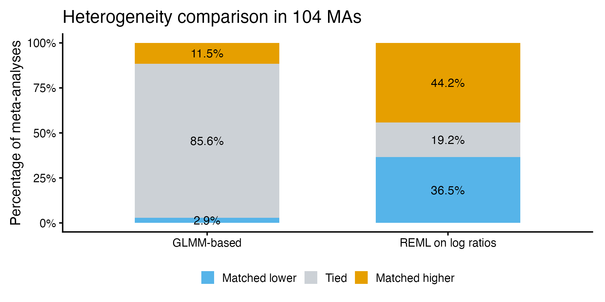
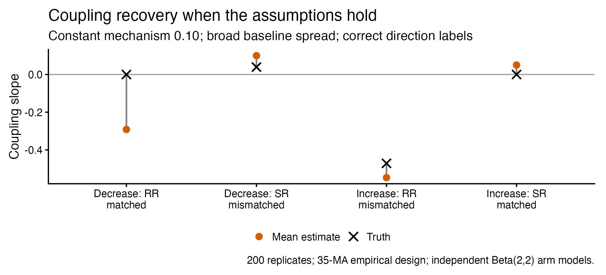
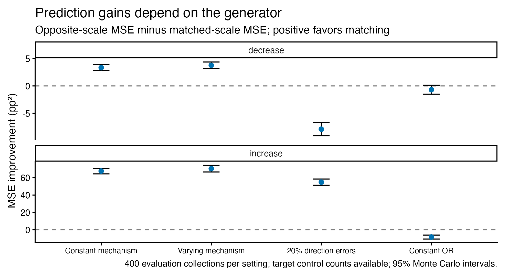
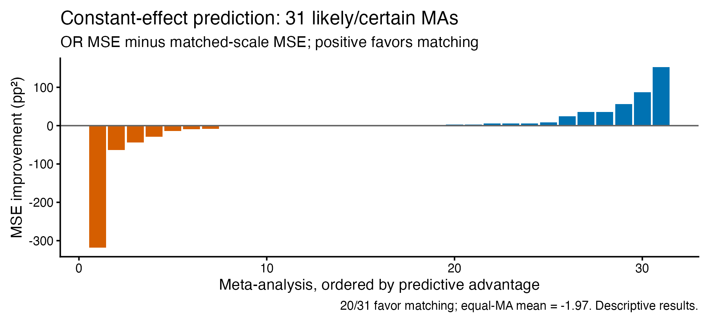

<!-- Insert this opening slide immediately after the main deck's title. -->

## Why this discussion?

- We are stuck: several analyses, mixed findings, and a potentially negative empirical result.
- Some difficulties concern the estimators; others may concern the scientific assumptions or the available data.
- We want to turn this work into a coherent paper, with a clear question and an honest account of what we learned.

**Today:** which findings belong in that paper, and what still needs resolving?

::: {.notes}
This is a methodological discussion, not a finished positive-results presentation.
A negative result is a possible outcome, not a conclusion established in advance.
The aim is to identify a defensible contribution rather than to include every implementation simply because work went into it.
:::

<!-- Replace the analysis overview / primary / secondary / Bayesian placeholders
     after the exploratory figures with the following main sequence. -->

## Three empirical questions {#three-questions}

Under monotonicity and constant mechanism strength, the direction-matched scale is stable across baseline risks.

| Question | Empirical target |
|---|---|
| **Heterogeneity** | Is between-trial variation smaller on the matched scale? |
| **Coupling** | Is the matched effect less associated with baseline risk? |
| **Prediction** | Does matching improve prediction of another trial? |

Matched = RR for an expected decrease in $P(Y=1)$; SR for an expected increase.

::: {.notes}
These are different estimands, not interchangeable tests of individual-level monotonicity.
Constancy requires an additional assumption about mechanism strength; monotonicity alone is insufficient.
Predictive comparisons depend on estimation, target information and loss as well as the data-generating relationship.
:::

## Heterogeneity: analysis {#heterogeneity-analysis}

**Observed data**

- Fit each MA on both RR and SR scales; compare between-trial heterogeneity.
- Classical analyses: paired comparisons and a second-stage mixed model with **MA and review random intercepts**.
- Bayesian extensions: per-MA fits followed by an across-MA model, or a joint single-stage hierarchy.

$$
\theta_m=\log(\tau_{m,\mathrm{matched}})
          -\log(\tau_{m,\mathrm{mismatched}}).
$$

Negative values favor the matched scale.

[Implementation and dependence](#analysis-details)

::: {.notes}
The displayed log-SD contrast expresses the Bayesian heterogeneity target.
The classical paired implementation uses log(tau2_matched + 1e-6) minus log(tau2_mismatched + 1e-6), not this exact formula.
Sources: analysis/01_primary.R, analysis/03_hierarchical.R, and analysis/bayesian_heterogeneity_{two,single}_stage.ipynb in effect-measure-stability.
The classical paired sample has 104 MAs and requires at least 3 studies, not the later 5-trial threshold.
The Bayesian hierarchy does not itself encode shared-review/shared-trial clustering.
:::

## Heterogeneity: what we learned

**Observed data · paired comparison**

{height=380px fig-alt="In 104 meta-analyses, heterogeneity ties occur in 85.6 percent with GLMM-based estimation and 19.2 percent with REML. The matched scale has lower estimates in 2.9 and 36.5 percent, respectively."}

Many estimates are tied at zero; the answer is sensitive to the estimator.

The early simulation assessed the paired test under a stylized design—not the entire analysis pipeline.

::: {.notes}
Source: output/tables/primary_results.csv. Matched lower/tied/higher proportions are computed from saved paired contrasts.
One-sided paired Wilcoxon p values: GLMM 0.941; metabin REML 0.652. These do not establish equivalence.
Mixed-model results and Bayesian analyses are separate; this figure does not summarize all of them.
simulation/simulation_calibration.R evaluates the paired heterogeneity test and explicitly skips the hierarchical model. It uses 500 MAs, 5–20 trials and 200 people per arm, not the empirical sparse-event design.
The draft paper reports calibration results; a separate saved replicate-level result was not located.
:::

## Baseline coupling: a more direct target {#coupling-analysis}

Let $\alpha=\operatorname{logit}(p_C)$ and $\beta=\log(\mathrm{RR})$ or $\log(\mathrm{SR})$.

$$
\kappa_m=\frac{\operatorname{Cov}_m(\alpha,\beta)}
                   {\operatorname{Var}_m(\alpha)}.
$$

| Expected direction | RR slope | SR slope |
|---|---:|---:|
| Decrease | $0$ | positive |
| Increase | negative | $0$ |

Classical regression uses observed control rates; Bayesian approaches estimate latent probabilities and their coupling.

**Difficulty:** control data enter both the baseline estimate and the effect estimate.

::: {.notes}
The displayed slope is the equal-study finite-MA projection used in the later coupling analyses, assuming baseline variation is nonzero. It is not a claim that both relationships are linear.
Classical meta-regression uses observed probability rather than logit baseline; its primary comparison is absolute z-statistics, with slope magnitude as sensitivity.
Shared estimation error can induce association; baseline measurement error is not simply independent classical error here.
Sources: analysis/02_secondary.R; docs/independent_binomial_coupling_methods.md; docs/baseline_coupling_revision_design.md.
Strict signs require positive mechanism strength and variation in baseline risk; under no effect both slopes are zero.
:::

## Coupling: can we recover the known truth?

**Simulation · independent-binomial estimator**

{height=390px fig-alt="True and mean estimated coupling slopes under a constant mechanism. The matched decrease RR slope is zero in truth but estimated at approximately minus 0.291."}

For the matched decrease/RR slope: truth **0**, mean estimate **−0.291**, nominal 95% interval coverage **0/200**.

::: {.notes}
Source: output/independent_binomial_coupling_direction_v2/report/evaluation/recovery.csv.
Selection: mechanism_010_0.8__perfect, prior 2, four cell means. Each point is a mean across 200 replicates; no uncertainty bars are implied.
35-MA/361-trial design, original arm sizes, baseline-logit SD 0.8, constant mechanism strength 0.10, correct expected-direction labels.
This demonstrates failure of this estimator under these settings. It does not show that the scientific prediction is false or that every estimator must fail.
:::

## Coupling: what additional information changes

**Simulation · independent-binomial estimator**

| Number of MAs | Bias of matched decrease/RR slope | Mean 95% interval width |
|---:|---:|---:|
| 35 | −0.285 | 0.209 |
| 140 | −0.291 | 0.107 |
| 350 | −0.288 | 0.067 |

More similar MAs narrowed intervals without removing within-MA bias.

Larger arms improved recovery in broad-baseline settings. Alternative estimators still faced weak information, bias or computational problems.

[Estimator revisions and simulations](#coupling-variants)

::: {.notes}
Source: docs/more_meta_analyses_results.md. Constant mechanism 0.10, baseline-logit SD 0.80, original participants/trial and trials/MA, 50 replicates per setting. Coverage for this cell was 0/50 at each MA count.
The separate information study varied participants by factors 10 and 100 and trials per MA by factor 4; substantial improvement at 100-times participants does not establish feasibility at the actual design.
Alternative studies evaluated corrected moments, Fieller sets, independent Beta priors and within-MA pooling. Do not conflate their diagnostics with this no-pooling estimator.
:::

## Prediction: does scale choice help? {#prediction-analysis}

**Source trials in an MA** → fit RR, SR or OR model

**Held-out control data** → estimate the target baseline

**Predict held-out treated outcome** → score after prediction

$$
\Delta L=L_{\mathrm{comparator}}-L_{\mathrm{matched}}.
$$

- Positive values favor matching, on a common treated-probability scale.
- Average held-out losses within MA, then weight MAs equally.
- Separate **random-effects prediction** from the later **constant-effect curve** analysis.

::: {.notes}
The held-out treated count is excluded from fitting and prediction, but the held-out control count is available. This is not prediction with no target information.
Matched is defined by the supplied direction label, not observed prediction performance.
Sources: docs/real_rct_prediction_protocol_v1.md and docs/monotonicity_validation_protocol_v3.md.
Simulation can score latent treated probabilities; actual data score observed treated proportions. Paired expected loss differences agree under the held-out binomial task, but observed losses retain sampling uncertainty.
:::

## Random-effects prediction: simulation

**Simulation · exact-binomial RR/SR/OR models**

{height=430px fig-alt="Matched versus opposite-scale predictive MSE gains in four generators, split by expected direction. Gains vary and can reverse with direction errors or constant OR."}

::: {.notes}
Source: output/new_rct_prediction/v1/results/performance_contrasts.csv.
Base prior, no target baseline shift, target controls available, latent MSE contrast, opposite-scale comparator. Four selected generators C2/V1/V4/O1, 400 evaluation collections each. Each panel has its own y-axis range.
The broader study completed 9,600 collection jobs across reference/evaluation and prior streams; these are not 9,600 independent replications of one contrast.
Each MA contributes two held-out targets per simulation collection. Target uncertainty includes a new random effect; RR/SR distributions respect probability constraints.
Mean-performance intervals undercovered in some scenarios; Monte Carlo intervals in this plot quantify simulation precision, not uncertainty for one observed-data sample.
:::

## Random-effects prediction: observed data

**Observed data · 35 MAs, 361 held-out trials**

| Comparator | Mean MSE improvement from matching |
|---|---:|
| Opposite scale | +14.95 |
| OR | +2.29 |

Units: squared percentage points; positive favors matching.

- Descriptive mean errors favor matching, but the comparison depends on direction and loss function.
- Average-performance intervals were not adequately calibrated across simulation settings.
- These results do not establish predictive superiority or identify a causal mechanism.

[Prediction methods and calibration](#prediction-details)

::: {.notes}
Source: output/real_rct_prediction/v1/results.md; 24 decrease and 11 increase MAs. Full leave-one-trial-out evaluation, equal-MA overall aggregation.
Against OR, direction-specific squared-error improvements are +5.28 for decrease and −4.24 for increase. Overall log-score improvement against OR is −0.031, illustrating dependence on loss.
The source model uses exact binomial random effects; later constant-curve prediction uses a different estimator and sample.
Selection: likely/certain, known direction, at least five distinct trials, one MA per review, no shared corrected trial identities. Zero/all-event arms retained.
:::

## Constant-effect curves: fit and prediction

**Observed data · later profile-likelihood analysis**

{height=350px fig-alt="Per-MA prediction advantages versus constant OR in 31 likely/certain MAs. Twenty favor matching, but the overall mean is slightly negative."}

No demonstrated average advantage over OR; the predictive interval failed its sample-size-specific calibration gate.

Strict constant-directional fit flagged **10/31** likely/certain and **16/60** unlikely MAs after nominal BH correction.

::: {.notes}
Sources: output/monotonicity_validation/v3/real_ma_results.csv and docs/monotonicity_validation_results.md.
31 likely/certain MAs (314 trials), 60 unlikely MAs (644 trials). A different selected sample from the October 35-MA random-effects analysis.
Profile likelihood fits constant RR/SR/OR; target baseline averaged under a support-conditioned Jeffreys posterior. Separate bootstrap test constrains the matched log ratio to be nonpositive.
480,000 independent simulated MA datasets plus 1,200 bootstrap-calibration MAs. Nominal 95% predictive coverage at 31 MAs ranged 87.5–95.0%; approximate bootstrap rejection calibration ranged 4–8.5% under nominal 5%.
The observed mean advantage is −0.000197 squared probability (about −1.97 squared percentage points). The unvalidated interval is not shown as a calibrated confidence interval.
Fit rejections concern constant effect plus expected direction, not individual-level monotonicity alone. Failure to reject does not establish either assumption.
:::

## What would make a coherent paper? {#paper-discussion}

**Candidate question:** does expected treatment direction help choose an effect scale for evidence synthesis?

- **Empirical assessment:** heterogeneity and prediction results are mixed; selection and uncertainty matter.
- **Methodological finding:** intuitive coupling diagnostics can fail even when the generating assumptions hold.
- **Possible contribution:** explain when scale matching helps, when estimation obscures it, and what these data cannot establish.

**Discussion:** which endpoint should lead—and what minimum additional work would make the conclusion defensible?

::: {.notes}
Potential paper structure: theoretical motivation; empirical sample and external labels; one main endpoint; simulations tied to that endpoint; empirical evaluation; limitations and implications.
Ask specifically about shared-control estimation error, uncertainty for equal-MA predictive comparisons, and robustness to direction/monotonicity labels.
Do not turn every implementation into a co-primary analysis. Label exploratory revisions and historical versions transparently. A potential negative empirical result can be publishable without claiming the underlying theory is disproved.
:::

<!-- Append these optional details after the existing principal-strata appendix. -->

# Analysis appendix

## Implementation and dependence {#analysis-details}

| Analysis | Dependence handling |
|---|---|
| Classical paired tests | RR/SR paired within MA |
| Second-stage heterogeneity mixed model | MA and review random intercepts |
| Bayesian heterogeneity notebooks | Across-MA hierarchy; no explicit review/shared-trial effect |
| Later coupling/prediction samples | One MA per review; exclude repeated corrected trial IDs |

Review effects do not encode the exact covariance from shared trials across reviews.

[Back to heterogeneity](#heterogeneity-analysis)

## Coupling variants and their status {#coupling-variants}

| Approach | What was done | Main limitation |
|---|---|---|
| Shared-binomial v2 | 91-MA empirical fit; development simulations | Strict diagnostic failure; incomplete recovery checks |
| Independent arms | Large simulation panels; label/information variations | Biased slopes and poor coverage |
| Corrected moments / Fieller | Small development panels | Undefined points or unbounded intervals |
| Within-MA pooling | 60 collections each at 35 and 350 MAs | Only 14/60 and 3/60 passed original diagnostics |

[Back to coupling](#coupling-analysis)

::: {.notes}
Sources: docs/coupling_revision_v2_report_20260917.md; docs/independent_binomial_coupling_report.md; docs/coupling_interval_bayesian_development_20260923.md; docs/coupling_shared_binomial_v1_feasibility_20260923.md; docs/coupling_shared_binomial_ma350_review_20260928.md.
The 350-MA result uses the original strict diagnostic screen; 23/60 passed a post hoc relaxed screen. Completed computation is not successful calibration.
:::

## Prediction methods and calibration {#prediction-details}

| Method | Target and uncertainty |
|---|---|
| Early feasibility benchmark | Transport mean log effect to known target baseline; no new-trial random effect |
| October random-effects models | New target effect plus baseline uncertainty; RR/SR/OR |
| November constant-effect curves | Common-effect point fit; baseline uncertainty; separate bootstrap fit test |

The later simulations evaluate different procedures; they do not validate the earlier ones retrospectively.

[Back to prediction](#prediction-analysis)

## Analysis populations

| Dataset / analysis | MA count |
|---|---:|
| Descriptive canonical export | 1,291 |
| At least five distinct RCTs | 389 |
| Certain/likely monotonic, at least five RCTs | 65 |
| Same, known direction | 54 |
| October prediction: selected independent MAs | 35 |
| November curves: selected likely/certain MAs | 31 |

Different versions use different selection rules and samples; these are not interchangeable denominators.

[Back to discussion](#paper-discussion)

::: {.notes}
The 35- versus 31-MA sets come from separate frozen selection workflows; this table is not a single sequential attrition flow.
The November analysis additionally includes 60 unlikely MAs. The earlier paired heterogeneity result uses 104 MAs under its own >=3-study criterion.
Sources: figs/exploratory/provenance.json; docs/real_rct_prediction_protocol_v1.md; docs/monotonicity_validation_results.md.
:::
