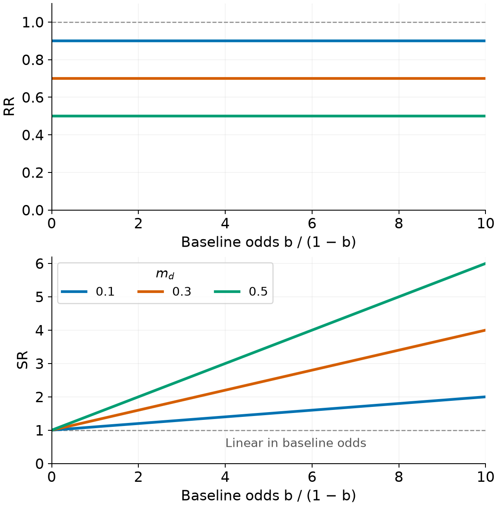
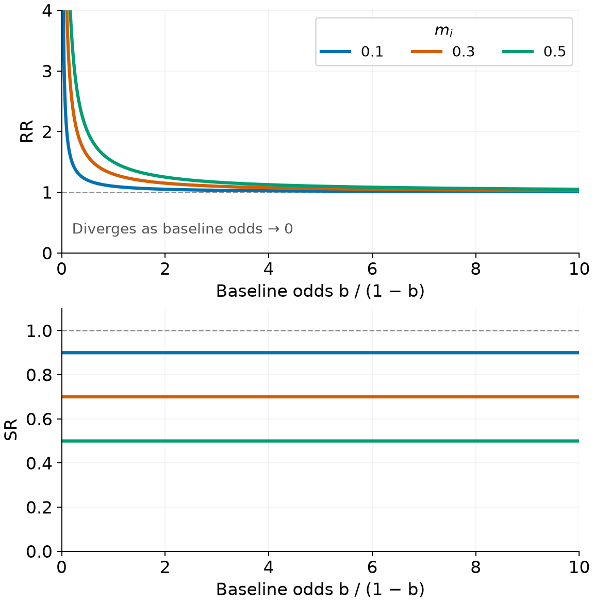
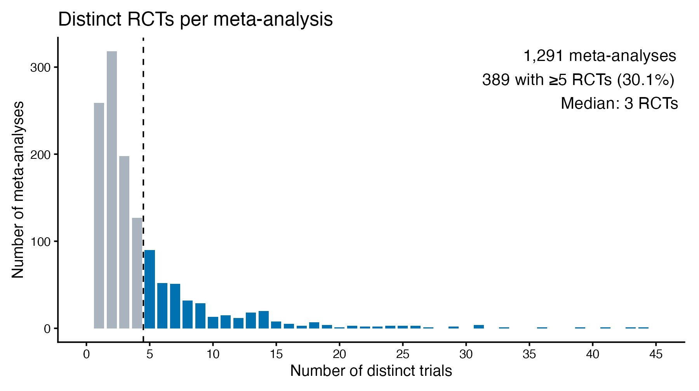
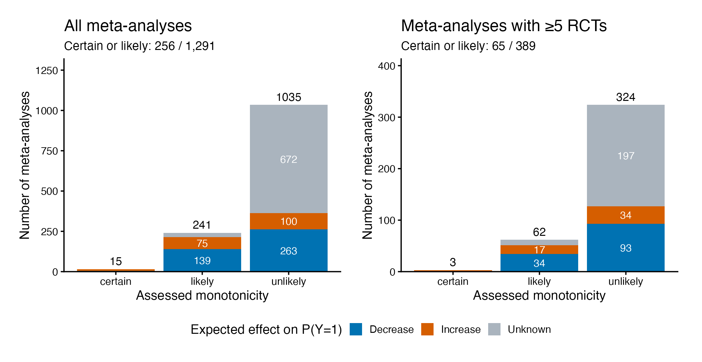
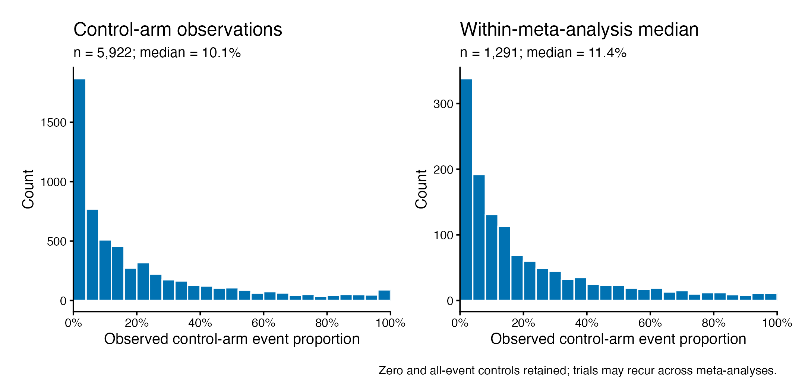
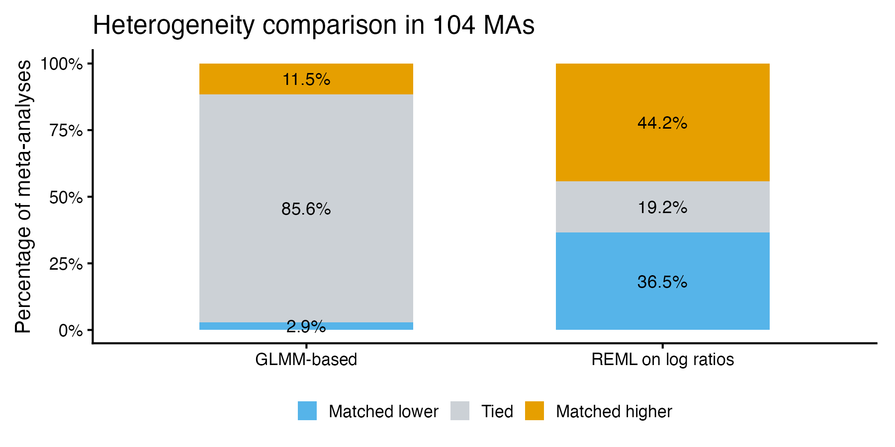
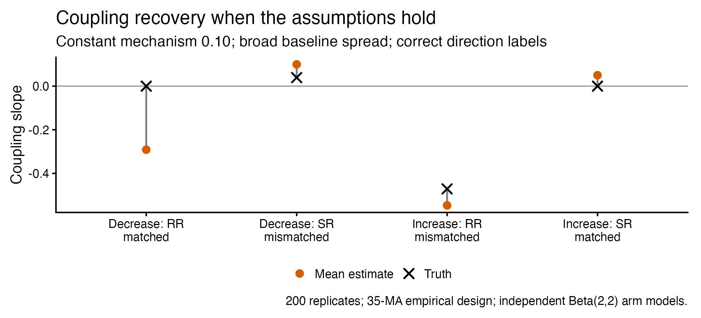
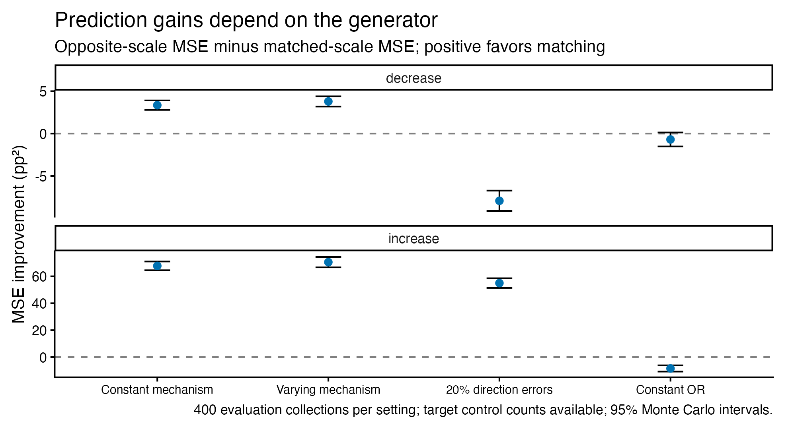
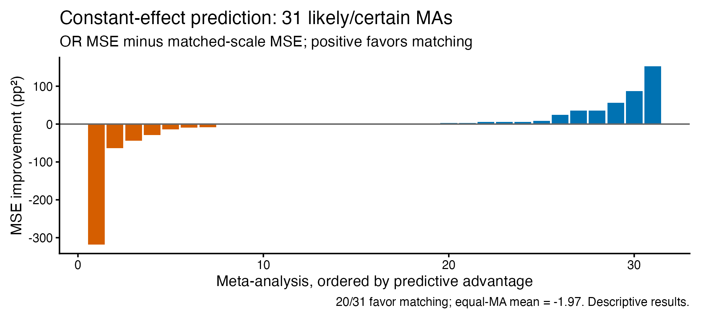

## Why this discussion?

- We are stuck: several analyses, mixed findings, and a potentially negative empirical result.
- Some difficulties concern the estimators; others may concern the scientific assumptions or the available data.
- We want to turn this work into a coherent paper, with a clear question and an honest account of what we learned.

. . .

**Today:** which findings belong in that paper, and what still needs resolving?

::: {.notes}
This is a methodological discussion, not a finished positive-results presentation.
A negative result is a possible outcome, not a conclusion established in advance.
The aim is to identify a defensible contribution rather than to include every implementation simply because work went into it.
:::

# Motivation

## History

- April 2023, read paper "Risk Ratio, odds ratio, risk difference... Which causal  measure is easier to generalize?", Colnet et al
- Reached out to Benedicte Colnet, had a conversation
- Thought of an empirical project to test an hypothesis inspired by the paper
- Early 2024, Rodrigue Ndabashinze reached out to do his epidemiology MSc. thesis with me
- Jan 2025, started on this project, together with Valentijn de Jong
- May 2025, presented progress to Julie Josse and colleagues (remotely)
- ... - now, statistical analysis

## Effects of interventions

- In healthcare we need to make decisions regarding interventions ('treatments'), based on their 'effects'
- Let $Y^0,Y^1$ be potential outcomes under treatment $0$ and $1$ respectively:

. . . 

$$ \Psi = f(E[Y^0], E[Y^1]) $$

- If $Y$ is binary, $\Psi$ could be a risk difference ($\Psi_{rd}$), risk ratio ($\Psi_{rr}$), survival ratio ($\Psi_{sr}$), number needed to treat, odds ratio, etc.

## Estimating effects

- We get estimates of treatment effects from RCTs, as these give us random samples from $P(Y^0),P(Y^1)$, $D=$

. . .

|           | $Y=0$                      | $Y=1$                      |
|-----------|----------------------------|----------------------------|
| control   | $\sum_{i}^{n_0} Y_i^0 = 0$ | $\sum_{i}^{n_0} Y_i^0 = 1$ |
| treatment | $\sum_i^{n_1} Y_i^1 = 0$   | $\sum_i^{n_1} Y_i^1 = 1$   |

  <!-- $$D = \{\sum_{i}^{n_0} Y_i^0 = 1, \sum_{i}^{n_0} Y_i^0 = 0, \sum_i^{n_1} Y_i^1 = 1, \sum_i^{n_1} Y_i^1 = 0 \}$$ -->

- For a well-conducted RCT, many choices $\Psi$ are a *valid* measure of the treatment effect

## How to use the RCT evidence?

- Typical highest standard of evidence: have a series of all $k$ published RCT results, $D_1, \ldots, D_k$.
- Calculate *an* effect meausre $\Psi_i$ for each trial (with variance estimate $v_i$), and then combine them to get a single estimate with *meta-analysis*.

. . .

\begin{aligned}
\Psi_i &\;\sim\; N \bigl(\mu,\;v_i\bigr), \quad i=1,\dots,k
\end{aligned}

- $\mu$ is *overall* effect measure; $\Psi$ typically on log scale, or risk difference
- this is a 'fixed effects' model with a single underlying treatment effect

## Heterogeneity poses challenges for decision making

- $\Psi$ is a functional of the underlying joint distribution of $Y^0$ and $Y^1$, which may depend on covariates $X$ among other factors:

. . .

$$ \Psi(x) = f(E[Y^0|X=x], E[Y^1|X=x]) $$

- Need to make a decision on interventions for *a specific* subpopulation ('target') with a specific distribution: $P^*(Y^0,Y^1,X)$

## Issues with trial evidence

- Trials are typically conducted in specific subpopulations, which
  a. may not *cover* $P^*(X)$ (e.g. elderly, pregnant women and children are often excluded)
  b. may have a different disctribution of $X$
- (when) are the trial results generalizable to the target population?

## Meta-analysis with random effects

\begin{aligned}
\Psi_i \mid \theta_i &\;\sim\; N \bigl(\theta_i,\;v_i\bigr), \quad i=1,\dots,k \\[6pt]
\theta_i \mid \mu,\tau &\;\sim\; N\bigl(\mu,\;\tau^{2}\bigr)
\end{aligned}

- $\mu$ is *overall* effect measure, $\tau$ is *heterogeneity* of the effect measure (which could be 0)
- this is a *random effects* model, setting $\tau=0$ retreives the 'fixed effects' model

## Motivation

- Need to make assumptions to pick best measure for:
  - learning about our target population
  - decision making
- Though many choices of $\Psi$ (risk ratio, survival ratio, risk difference, ...) are *causally valid* measures of treatment effect, not all of them are created equally when it comes to their dependence on the underlying joint distribution of $Y^0$ and $Y^1$, i.e. their *generalizability*.
- Colnet showed that for treatments with *monotonic* effects (never hurting or never benefitting), the conditional *risk ratio* (/*survival ratio*) may be decoupled from baseline risk

# Risk ratio, survival ratio, risk difference ,...

## Russian roulette

When playing Russion roulette, the risk of dying is 1/6 if you play, and 0 if you don't.
<!-- The risk ratio is 1/6, the survival ratio is 5/6, and the risk difference is 1/6. If you play, you die with probability 1/6, and if you don't play, you die with probability 0. -->
Say we want to measure the effect of forcing people to undergo Russion roulette with a randomized trial.

- outcome: death in 30 days
- intervention: forcing people to play Russion roulette, or 'care as usual'

. . . 

In the control arm, for patients with covariates $X=x$, there is a risk $0 \leq b(x) \leq 0$ of dying in 30 days due to other causes.
Writing $a=1$ for roulette and $a=0$ for control assignment, we have

$$
P\bigl(Y^{a=0} = 1 \mid X = x\bigr)
=
b(x)
$$

## Russian roulette ctd.

A person can either die from Russion roulette or from other causes (or not at all), so the total risk of death is:

$$
P\bigl(Y^a = 1 \mid X = x\bigr)
=
b(x) + a\,\underbrace{(1-b(x))\frac{1}{6}}_{\text{additional risk}}.
$$

We'll calculate a few different effect measures, averaged over the covariate distribution in population $P$

## Roulette: risk difference

Average over the covariate distribution in population $P$:

$$
\begin{aligned}
\psi_{\mathrm{RD}}^P
&:= P(Y^1=1) - P(Y^0=1) \\
&= \mathbb{E}_P\!\left[b(X)+\frac{1-b(X)}{6}\right]
 - \mathbb{E}_P[b(X)] \\
&= \frac{1}{6}\bigl(1-\mathbb{E}_P[b(X)]\bigr).
\end{aligned}
$$

The risk difference depends on baseline risk:

$$
\lim_{\mathbb{E}_P[b(X)]\to 1}\psi_{\mathrm{RD}}^P=0.
$$

## Roulette: risk ratio

For $\mathbb{E}_P[b(X)]>0$,

$$
\begin{aligned}
\psi_{\mathrm{RR}}^P
&:= \frac{P(Y^1=1)}{P(Y^0=1)} \\
&= \frac{\mathbb{E}_P[b(X)]+\frac{1}{6}\bigl(1-\mathbb{E}_P[b(X)]\bigr)}
        {\mathbb{E}_P[b(X)]} \\
&= 1+\frac{1-\mathbb{E}_P[b(X)]}{6\,\mathbb{E}_P[b(X)]}.
\end{aligned}
$$

The risk ratio also depends on baseline risk:

$$
\lim_{\mathbb{E}_P[b(X)]\to 0^+}\psi_{\mathrm{RR}}^P=\infty,
\qquad
\lim_{\mathbb{E}_P[b(X)]\to 1}\psi_{\mathrm{RR}}^P=1.
$$

## Roulette: survival ratio

For $\mathbb{E}_P[b(X)]<1$,

$$
\begin{aligned}
\psi_{\mathrm{SR}}^P
&:= \frac{P(Y^1=0)}{P(Y^0=0)} \\
&= \frac{1-\mathbb{E}_P\!\left[b(X)+\frac{1-b(X)}{6}\right]}
        {1-\mathbb{E}_P[b(X)]} \\
&= \frac{\frac{5}{6}\bigl(1-\mathbb{E}_P[b(X)]\bigr)}
        {1-\mathbb{E}_P[b(X)]} \\
&= \frac{5}{6}.
\end{aligned}
$$

The survival ratio is constant across populations with different baseline risks.

## Lemma 6 {#lemma-6-model}

 **Lemma 6 (Entanglement Model).** For a binary outcome $Y$, assume
  $0 < p_a(x) < 1$ for all $x \in \mathcal{X}$ and $a \in \{0,1\}$, where

  $$
  p_a(x) := P\bigl(Y^a = 1 \mid X = x\bigr).
  $$

  Define

  $$
  \begin{aligned}
  m_{\text{decrease}}(x) &:= P\bigl(Y^1 = 0 \mid Y^0 = 1, X = x\bigr), \\
  m_{\text{increase}}(x) &:= P\bigl(Y^1 = 1 \mid Y^0 = 0, X = x\bigr).
  \end{aligned}
  $$

  Then, writing $b(x) := p_0(x)$,

  $$
  P\bigl(Y^a = 1 \mid X = x\bigr)
  =
  b(x) + a\bigl[(1-b(x))m_i(x) - b(x)m_d(x)\bigr].
  $$

. . . 

For Russian roulette, $m_d(x)=0$, $m_i(x)=1/6$, recovering the previous result.

[Optional: connection to principal stratification](#principal-strata)

## Project hypotheses

- For meta-analyses of RCTs, if we assume:
  - treatment is **monotonic** (never harms or never benefits)

    $$m_d(x)=0\quad\text{or}\quad m_i(x)=0,$$

  - RCTs differ in **baseline risk**, but not **treatment effect** (on appropriate scale)

    $$\psi(x)=\psi\quad\text{for all }x,$$

- Performing meta-analyses for risk-ratio and survival-ratio and yield very different answers.
  - 'Incorrect' scale: $\psi$ depends linearly on odds of baseline risk
  - Higher variance

## Monotonic decrease in the outcome

:::: {.columns}
::: {.column width="48%"}

$b=P(Y^0=1)$; $0<b<1$.

**Assumptions:** $Y^1\leq Y^0$, $m_i=0$, and $m_d(x)=m_d$ across populations.

$$p_1=b(1-m_d).$$

$$\mathrm{RR}(b)=1-m_d$$

$$\mathrm{SR}(b)=1+m_d\frac{b}{1-b}$$

RR is constant; SR increases with baseline risk.

:::
::: {.column width="52%"}

{width=100% fig-alt="RR is constant; SR increases linearly with baseline odds b/(1-b). Curves show m_d equal to 0.1, 0.3, and 0.5."}

:::
::::

## Monotonic increase in the outcome

:::: {.columns}
::: {.column width="48%"}

$b=P(Y^0=1)$; $0<b<1$.

**Assumptions:** $Y^1\geq Y^0$, $m_d=0$, and $m_i(x)=m_i$ across populations.

$$p_1=b+(1-b)m_i.$$

$$\mathrm{RR}(b)=1+m_i\frac{1-b}{b}$$

$$\mathrm{SR}(b)=1-m_i$$

SR is constant; RR approaches 1 as baseline risk increases.

:::
::: {.column width="52%"}

{width=100% fig-alt="RR decreases toward 1 with increasing baseline odds b/(1-b); SR is constant. Curves show m_i equal to 0.1, 0.3, and 0.5."}

:::
::::

## Consequences for meta-analysis

1. meta-analyses with varying baseline risks should see a coupling between baseline risk and either RR or SR (visible in 'meta-regression')
2. as a consequence, one or the other scale may see different heterogeneity ($\tau$) estimates
3. a meta-analysis on the 'appropriate' scale estimates a treatment effect that is both directly relevant to other populations and has lower uncertainty (all else equal)

# Project set-up: an empirical evalution of the theory

## Study main steps

1. Go to library of meta-analyses of RCTs (Cochrane)
2. Do wide search for meta-analyses of RCTs of interventions
3. Pull RCT-level aggregated data from Cochrane library of random sample of 1000 RCTs
4. Classify every outcome in every meta-analysis as *increase* or *decrease*
5. Assess whether the treatment effect is likely *monotonic* (based on subject-matter knowledge)
6. Look for statistical evidence about the predictions from the theory

## Exploratory analysis: RCTs per meta-analysis

{height=450px fig-alt="Distribution of distinct RCTs per meta-analysis: 1,291 groups, median 3 RCTs; 389 groups (30.1%) contain at least five RCTs."}

MA = review × comparison × outcome × subgroup; RCTs counted uniquely within each MA.

::: {.notes}
Source: effect-measure-stability/data/processed/per_study_data.csv.
Full canonical export, before model-convergence filtering or primary-analysis selection.
Count distinct trial_id within ma_id. Trials can recur across MAs.
Reproduce with scripts/exploratory_figures.py; source hash and definitions in figs/exploratory/provenance.json.
:::

## Exploratory analysis: monotonicity and direction

{height=450px fig-alt="Monotonicity and expected direction for all 1,291 meta-analyses and the 389 with at least five RCTs. Certain or likely monotonicity: 256 overall and 65 with at least five RCTs."}

Of the 65 certain/likely MAs with ≥5 RCTs: **34 decrease**, **20 increase**, **11 unknown**.

::: {.notes}
Monotonicity is a subject-matter screening assessment, not established empirically.
Direction refers to increasing or decreasing P(Y=1), not outcome valence.
Across all 256 certain/likely MAs: 144 decrease, 85 increase, 27 unknown.
Panels have different count-axis ranges. Further primary-analysis exclusions have not been applied.
:::

## Exploratory analysis: baseline rates

{height=450px fig-alt="Observed control-arm event proportions: 5,922 control observations with median 10.1%; medians within 1,291 meta-analyses have overall median 11.4%."}

Baseline rate = control events / control participants; **798 zero-event** and **66 all-event** controls.

::: {.notes}
Identical control counts within an MA/trial are counted once; distinct control observations are retained.
The left panel weights control observations equally; the right weights MA groups equally using each group's median.
Trials may recur across MAs, so observations are not independent.
Includes zero and all-event controls, before primary-analysis exclusions.
:::

<!-- ## Analysis approaches -->
<!---->
<!-- Dependence is handled differently across approaches: -->
<!---->
<!-- - paired comparisons of RR and SR within each MA -->
<!-- - second-stage hierarchical heterogeneity analysis: random intercepts for MA and Cochrane review -->
<!-- - later coupling and prediction analyses: select one MA per review, excluding shared trial IDs across selected MAs -->
<!---->
<!-- Shared-trial dependence is not explicitly modeled in the earlier analyses. -->
<!---->
<!-- ::: {.notes} -->
<!-- The classical paired tests in 01_primary.R and 02_secondary.R do not adjust for review-level clustering. -->
<!-- The second-stage mixed model in 03_hierarchical.R includes (1 | cochrane_id) + (1 | group_idx), for both GLMM- and metabin-based heterogeneity estimates. -->
<!-- The review intercept models clustering within reviews; it does not encode the precise covariance from overlapping trials or link trials shared across different reviews. -->
<!-- The Bayesian notebooks inspected pool across MAs without explicit review or shared-trial random effects. -->
<!-- Later selection removes known review/trial overlap, but cannot rule out unidentified shared participants. -->
<!-- ::: -->

## Three empirical questions {#three-questions}

Under monotonicity and constant mechanism strength, the direction-matched scale is stable across baseline risks.

| Question | Empirical target |
|---|---|
| **Heterogeneity** | Is between-trial variation smaller on the matched scale? |
| **Coupling** | Is the matched effect less associated with baseline risk? |
| **Prediction** | Does matching improve prediction of another trial? |

Matched = RR for an expected decrease in $P(Y=1)$; SR for an expected increase.

::: {.notes}
These are different estimands, not interchangeable tests of individual-level monotonicity.
Constancy requires an additional assumption about mechanism strength; monotonicity alone is insufficient.
Predictive comparisons depend on estimation, target information and loss as well as the data-generating relationship.
:::

## Heterogeneity: analysis {#heterogeneity-analysis}

**Observed data**

- Fit each MA on both RR and SR scales; compare between-trial heterogeneity.
- Classical analyses: paired comparisons and a second-stage mixed model with **MA and review random intercepts**.
- Bayesian extensions: per-MA fits followed by an across-MA model, or a joint single-stage hierarchy.

. . . 

$$
\theta_m=\log(\tau_{m,\mathrm{matched}})
          -\log(\tau_{m,\mathrm{mismatched}}).
$$

Negative values favor the matched scale.

[Implementation and dependence](#analysis-details)

::: {.notes}
The displayed log-SD contrast expresses the Bayesian heterogeneity target.
The classical paired implementation uses log(tau2_matched + 1e-6) minus log(tau2_mismatched + 1e-6), not this exact formula.
Sources: analysis/01_primary.R, analysis/03_hierarchical.R, and analysis/bayesian_heterogeneity_{two,single}_stage.ipynb in effect-measure-stability.
The classical paired sample has 104 MAs and requires at least 3 studies, not the later 5-trial threshold.
The Bayesian hierarchy does not itself encode shared-review/shared-trial clustering.
:::

## Heterogeneity: what we learned

**Observed data · paired comparison**

{height=380px fig-alt="In 104 meta-analyses, heterogeneity ties occur in 85.6 percent with GLMM-based estimation and 19.2 percent with REML. The matched scale has lower estimates in 2.9 and 36.5 percent, respectively."}

Many estimates are tied at zero; the answer is sensitive to the estimator.

The early simulation assessed the paired test under a stylized design—not the entire analysis pipeline.

::: {.notes}
Source: output/tables/primary_results.csv. Matched lower/tied/higher proportions are computed from saved paired contrasts.
One-sided paired Wilcoxon p values: GLMM 0.941; metabin REML 0.652. These do not establish equivalence.
Mixed-model results and Bayesian analyses are separate; this figure does not summarize all of them.
simulation/simulation_calibration.R evaluates the paired heterogeneity test and explicitly skips the hierarchical model. It uses 500 MAs, 5–20 trials and 200 people per arm, not the empirical sparse-event design.
The draft paper reports calibration results; a separate saved replicate-level result was not located.
:::

## Baseline coupling: a more direct target {#coupling-analysis}

Let $\alpha=\operatorname{logit}(p_C)$ and $\beta=\log(\mathrm{RR})$ or $\log(\mathrm{SR})$.

$$
\kappa_m=\frac{\operatorname{Cov}_m(\alpha,\beta)}
                   {\operatorname{Var}_m(\alpha)}.
$$

| Expected direction | RR slope | SR slope |
|---|---:|---:|
| Decrease | $0$ | positive |
| Increase | negative | $0$ |

Classical regression uses observed control rates; Bayesian approaches estimate latent probabilities and their coupling.

**Difficulty:** control data enter both the baseline estimate and the effect estimate.

::: {.notes}
The displayed slope is the equal-study finite-MA projection used in the later coupling analyses, assuming baseline variation is nonzero. It is not a claim that both relationships are linear.
Classical meta-regression uses observed probability rather than logit baseline; its primary comparison is absolute z-statistics, with slope magnitude as sensitivity.
Shared estimation error can induce association; baseline measurement error is not simply independent classical error here.
Sources: analysis/02_secondary.R; docs/independent_binomial_coupling_methods.md; docs/baseline_coupling_revision_design.md.
Strict signs require positive mechanism strength and variation in baseline risk; under no effect both slopes are zero.
:::

## Coupling: can we recover the known truth?

**Simulation · independent-binomial estimator**

{height=390px fig-alt="True and mean estimated coupling slopes under a constant mechanism. The matched decrease RR slope is zero in truth but estimated at approximately minus 0.291."}

For the matched decrease/RR slope: truth **0**, mean estimate **−0.291**, nominal 95% interval coverage **0/200**.

::: {.notes}
Source: output/independent_binomial_coupling_direction_v2/report/evaluation/recovery.csv.
Selection: mechanism_010_0.8__perfect, prior 2, four cell means. Each point is a mean across 200 replicates; no uncertainty bars are implied.
35-MA/361-trial design, original arm sizes, baseline-logit SD 0.8, constant mechanism strength 0.10, correct expected-direction labels.
This demonstrates failure of this estimator under these settings. It does not show that the scientific prediction is false or that every estimator must fail.
:::

## Coupling: what additional information changes

**Simulation · independent-binomial estimator**

| Number of MAs | Bias of matched decrease/RR slope | Mean 95% interval width |
|---:|---:|---:|
| 35 | −0.285 | 0.209 |
| 140 | −0.291 | 0.107 |
| 350 | −0.288 | 0.067 |

More similar MAs narrowed intervals without removing within-MA bias.

Larger arms improved recovery in broad-baseline settings. Alternative estimators still faced weak information, bias or computational problems.

[Estimator revisions and simulations](#coupling-variants)

::: {.notes}
Source: docs/more_meta_analyses_results.md. Constant mechanism 0.10, baseline-logit SD 0.80, original participants/trial and trials/MA, 50 replicates per setting. Coverage for this cell was 0/50 at each MA count.
The separate information study varied participants by factors 10 and 100 and trials per MA by factor 4; substantial improvement at 100-times participants does not establish feasibility at the actual design.
Alternative studies evaluated corrected moments, Fieller sets, independent Beta priors and within-MA pooling. Do not conflate their diagnostics with this no-pooling estimator.
:::

## Prediction: does scale choice help? {#prediction-analysis}

**Source trials in an MA** → fit RR, SR or OR model

**Held-out control data** → estimate the target baseline

**Predict held-out treated outcome** → score after prediction

$$
\Delta L=L_{\mathrm{comparator}}-L_{\mathrm{matched}}.
$$

- Positive values favor matching, on a common treated-probability scale.
- Average held-out losses within MA, then weight MAs equally.
- Separate **random-effects prediction** from the later **constant-effect curve** analysis.

::: {.notes}
The held-out treated count is excluded from fitting and prediction, but the held-out control count is available. This is not prediction with no target information.
Matched is defined by the supplied direction label, not observed prediction performance.
Sources: docs/real_rct_prediction_protocol_v1.md and docs/monotonicity_validation_protocol_v3.md.
Simulation can score latent treated probabilities; actual data score observed treated proportions. Paired expected loss differences agree under the held-out binomial task, but observed losses retain sampling uncertainty.
:::

## Random-effects prediction: simulation

**Simulation · exact-binomial RR/SR/OR models**

{height=430px fig-alt="Matched versus opposite-scale predictive MSE gains in four generators, split by expected direction. Gains vary and can reverse with direction errors or constant OR."}

::: {.notes}
Source: output/new_rct_prediction/v1/results/performance_contrasts.csv.
Base prior, no target baseline shift, target controls available, latent MSE contrast, opposite-scale comparator. Four selected generators C2/V1/V4/O1, 400 evaluation collections each. Each panel has its own y-axis range.
The broader study completed 9,600 collection jobs across reference/evaluation and prior streams; these are not 9,600 independent replications of one contrast.
Each MA contributes two held-out targets per simulation collection. Target uncertainty includes a new random effect; RR/SR distributions respect probability constraints.
Mean-performance intervals undercovered in some scenarios; Monte Carlo intervals in this plot quantify simulation precision, not uncertainty for one observed-data sample.
:::

## Random-effects prediction: observed data

**Observed data · 35 MAs, 361 held-out trials**

| Comparator | Mean MSE improvement from matching |
|---|---:|
| Opposite scale | +14.95 |
| OR | +2.29 |

Units: squared percentage points; positive favors matching.

- Descriptive mean errors favor matching, but the comparison depends on direction and loss function.
- Average-performance intervals were not adequately calibrated across simulation settings.
- These results do not establish predictive superiority or identify a causal mechanism.

[Prediction methods and calibration](#prediction-details)

::: {.notes}
Source: output/real_rct_prediction/v1/results.md; 24 decrease and 11 increase MAs. Full leave-one-trial-out evaluation, equal-MA overall aggregation.
Against OR, direction-specific squared-error improvements are +5.28 for decrease and −4.24 for increase. Overall log-score improvement against OR is −0.031, illustrating dependence on loss.
The source model uses exact binomial random effects; later constant-curve prediction uses a different estimator and sample.
Selection: likely/certain, known direction, at least five distinct trials, one MA per review, no shared corrected trial identities. Zero/all-event arms retained.
:::

## Constant-effect curves: fit and prediction

**Observed data · later profile-likelihood analysis**

{height=350px fig-alt="Per-MA prediction advantages versus constant OR in 31 likely/certain MAs. Twenty favor matching, but the overall mean is slightly negative."}

No demonstrated average advantage over OR; the predictive interval failed its sample-size-specific calibration gate.

Strict constant-directional fit flagged **10/31** likely/certain and **16/60** unlikely MAs after nominal BH correction.

::: {.notes}
Sources: output/monotonicity_validation/v3/real_ma_results.csv and docs/monotonicity_validation_results.md.
31 likely/certain MAs (314 trials), 60 unlikely MAs (644 trials). A different selected sample from the October 35-MA random-effects analysis.
Profile likelihood fits constant RR/SR/OR; target baseline averaged under a support-conditioned Jeffreys posterior. Separate bootstrap test constrains the matched log ratio to be nonpositive.
480,000 independent simulated MA datasets plus 1,200 bootstrap-calibration MAs. Nominal 95% predictive coverage at 31 MAs ranged 87.5–95.0%; approximate bootstrap rejection calibration ranged 4–8.5% under nominal 5%.
The observed mean advantage is −0.000197 squared probability (about −1.97 squared percentage points). The unvalidated interval is not shown as a calibrated confidence interval.
Fit rejections concern constant effect plus expected direction, not individual-level monotonicity alone. Failure to reject does not establish either assumption.
:::

## What would make a coherent paper? {#paper-discussion}

**Candidate question:** does expected treatment direction help choose an effect scale for evidence synthesis?

- **Empirical assessment:** heterogeneity and prediction results are mixed; selection and uncertainty matter.
- **Methodological finding:** intuitive coupling diagnostics can fail even when the generating assumptions hold.
- **Possible contribution:** explain when scale matching helps, when estimation obscures it, and what these data cannot establish.

. . .

**Discussion:** which endpoint should lead—and what minimum additional work would make the conclusion defensible?

::: {.notes}
Potential paper structure: theoretical motivation; empirical sample and external labels; one main endpoint; simulations tied to that endpoint; empirical evaluation; limitations and implications.
Ask specifically about shared-control estimation error, uncertainty for equal-MA predictive comparisons, and robustness to direction/monotonicity labels.
Do not turn every implementation into a co-primary analysis. Label exploratory revisions and historical versions transparently. A potential negative empirical result can be publishable without claiming the underlying theory is disproved.
:::

# Appendix

## Principal stratification: four response types {#principal-strata}

For $Y=1$ denoting death, define
$\pi_{ij}(x)=P(Y^0=i,Y^1=j\mid X=x)$.

| Response type | $Y^0$ | $Y^1$ | Probability |
|---|---:|---:|---|
| Always survives ("always cured") | 0 | 0 | $\pi_{00}(x)$ |
| Doomed | 1 | 1 | $\pi_{11}(x)$ |
| Saved when treated | 1 | 0 | $\pi_{10}(x)$ |
| Harmed when treated | 0 | 1 | $\pi_{01}(x)$ |

These latent groups use the joint-potential-outcome construction of principal stratification. Standard applications stratify on an intermediate variable and estimate effects on a separate endpoint.

[Frangakis & Rubin (2002)](https://pmc.ncbi.nlm.nih.gov/articles/PMC4137767/)

[Back to Lemma 6](#lemma-6-model)

## Lemma 6 reparameterizes the stratum proportions

Suppressing $x$, write $m_d=m_{\text{decrease}}$ and $m_i=m_{\text{increase}}$:

$$
b=\pi_{10}+\pi_{11},\qquad
m_d=\frac{\pi_{10}}{b},\qquad
m_i=\frac{\pi_{01}}{1-b}.
$$

Equivalently,

$$
\begin{aligned}
\pi_{00}&=(1-b)(1-m_i), & \pi_{01}&=(1-b)m_i,\\
\pi_{10}&=bm_d, & \pi_{11}&=b(1-m_d).
\end{aligned}
$$

Therefore,

$$
p_1-p_0
=\underbrace{\pi_{01}}_{\text{harmed}}
-\underbrace{\pi_{10}}_{\text{saved}}
=(1-b)m_i-bm_d.
$$

For $0<b<1$, these are equivalent parameterizations of the same joint distribution.

[Back to Lemma 6](#lemma-6-model)

## Identification: what does randomization give us?

An RCT identifies the marginal risks:

$$
p_0=\pi_{10}+\pi_{11},\qquad
p_1=\pi_{01}+\pi_{11}.
$$

It does not generally identify all four stratum proportions.

**Monotonicity removes one stratum:**

$$
\begin{aligned}
\text{No harm:}\quad &\pi_{01}=0
&&\Longrightarrow\quad \mathrm{RR}=1-m_d,\\
\text{No benefit:}\quad &\pi_{10}=0
&&\Longrightarrow\quad \mathrm{SR}=1-m_i.
\end{aligned}
$$

These identities hold conditional on $X=x$, with nonzero denominators. Stability across populations requires additional assumptions about $m_d(x)$ or $m_i(x)$.

For roulette: $m_d(x)=0$, $m_i(x)=1/6$, hence $\mathrm{SR}=5/6$.

[Back to Lemma 6](#lemma-6-model)

## Implementation and dependence {#analysis-details}

| Analysis | Dependence handling |
|---|---|
| Classical paired tests | RR/SR paired within MA |
| Second-stage heterogeneity mixed model | MA and review random intercepts |
| Bayesian heterogeneity notebooks | Across-MA hierarchy; no explicit review/shared-trial effect |
| Later coupling/prediction samples | One MA per review; exclude repeated corrected trial IDs |

Review effects do not encode the exact covariance from shared trials across reviews.

[Back to heterogeneity](#heterogeneity-analysis)

## Coupling variants and their status {#coupling-variants}

| Approach | What was done | Main limitation |
|---|---|---|
| Shared-binomial v2 | 91-MA empirical fit; development simulations | Strict diagnostic failure; incomplete recovery checks |
| Independent arms | Large simulation panels; label/information variations | Biased slopes and poor coverage |
| Corrected moments / Fieller | Small development panels | Undefined points or unbounded intervals |
| Within-MA pooling | 60 collections each at 35 and 350 MAs | Only 14/60 and 3/60 passed original diagnostics |

[Back to coupling](#coupling-analysis)

::: {.notes}
Sources: docs/coupling_revision_v2_report_20260917.md; docs/independent_binomial_coupling_report.md; docs/coupling_interval_bayesian_development_20260923.md; docs/coupling_shared_binomial_v1_feasibility_20260923.md; docs/coupling_shared_binomial_ma350_review_20260928.md.
The 350-MA result uses the original strict diagnostic screen; 23/60 passed a post hoc relaxed screen. Completed computation is not successful calibration.
:::

## Prediction methods and calibration {#prediction-details}

| Method | Target and uncertainty |
|---|---|
| Early feasibility benchmark | Transport mean log effect to known target baseline; no new-trial random effect |
| October random-effects models | New target effect plus baseline uncertainty; RR/SR/OR |
| November constant-effect curves | Common-effect point fit; baseline uncertainty; separate bootstrap fit test |

The later simulations evaluate different procedures; they do not validate the earlier ones retrospectively.

[Back to prediction](#prediction-analysis)

## Analysis populations

| Dataset / analysis | MA count |
|---|---:|
| Descriptive canonical export | 1,291 |
| At least five distinct RCTs | 389 |
| Certain/likely monotonic, at least five RCTs | 65 |
| Same, known direction | 54 |
| October prediction: selected independent MAs | 35 |
| November curves: selected likely/certain MAs | 31 |

Different versions use different selection rules and samples; these are not interchangeable denominators.

[Back to discussion](#paper-discussion)

::: {.notes}
The 35- versus 31-MA sets come from separate frozen selection workflows; this table is not a single sequential attrition flow.
The November analysis additionally includes 60 unlikely MAs. The earlier paired heterogeneity result uses 104 MAs under its own >=3-study criterion.
Sources: figs/exploratory/provenance.json; docs/real_rct_prediction_protocol_v1.md; docs/monotonicity_validation_results.md.
:::
